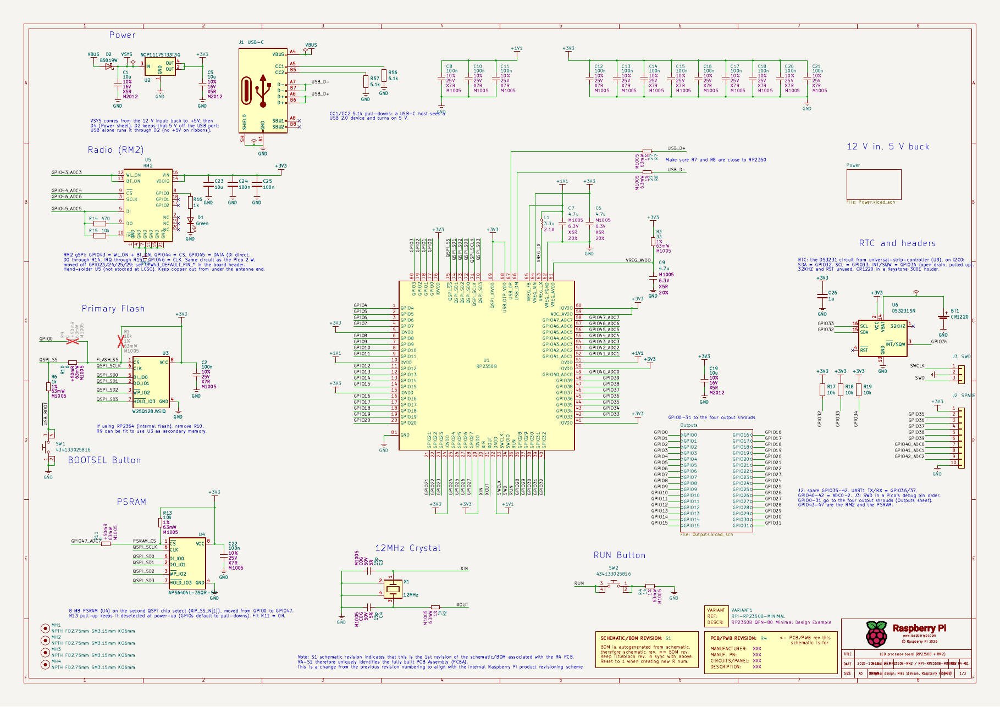
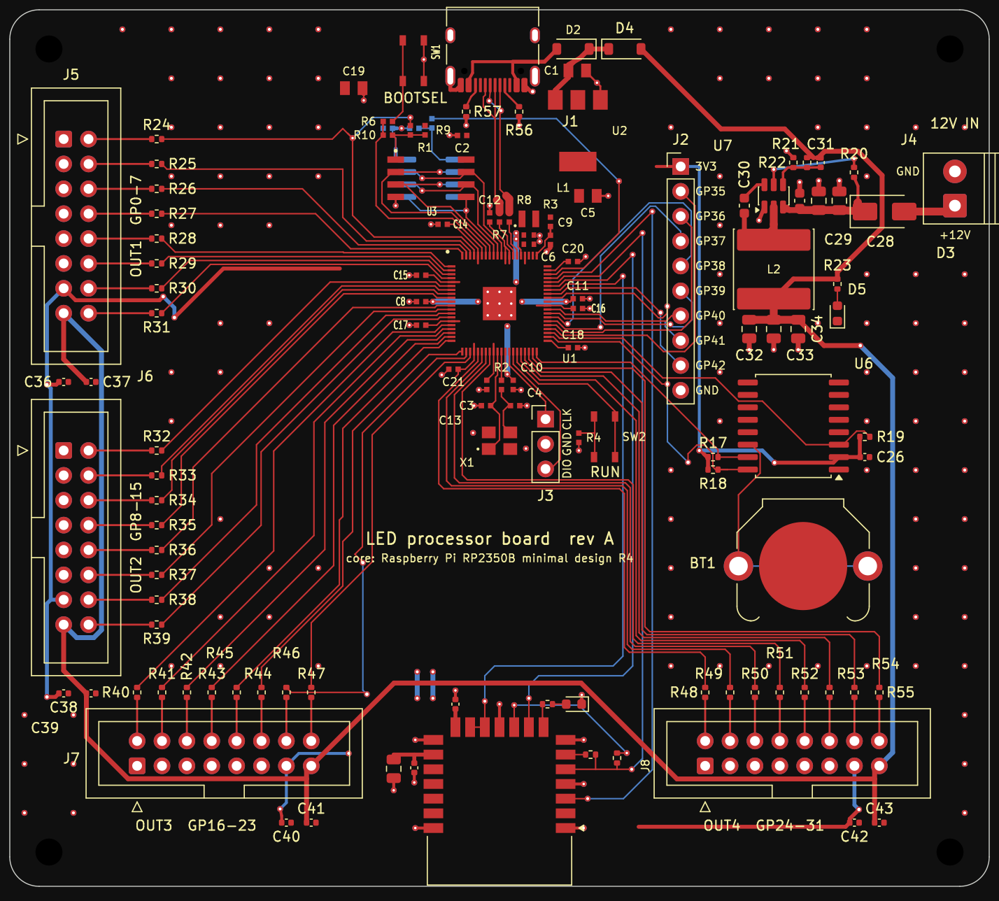

# LED processor board

The brains for the LED output boards: an RP2350B with an RM2 radio, 8 MB PSRAM, a DS3231 RTC and
four 16-pin ribbon shrouds. Each shroud drives one
[led-output-board](https://github.com/eelstretching/led-output-board), which does the level
shifting, fusing and strand connectors, so this board carries no LED power.

The core (RP2350B, flash, PSRAM, RM2, crystal, BOOTSEL/RUN buttons, 3.3 V regulator) is the
[rp2350b-rm2-reference](https://github.com/eelstretching/rp2350b-rm2-reference) schematic
unchanged, except that its micro-B USB is now USB-C. That board's single-row J2/J3 headers are
gone; the rest is new.

Status: **schematic and first layout done, not yet built.** ERC is clean apart from the four items
inherited from Pi's design, and DRC has no copper errors and nothing unconnected (see
"Verification").

All three sheets: [docs/schematic.pdf](docs/schematic.pdf) ([Power](docs/sheet-power.png), [Outputs](docs/sheet-outputs.png)).

## Pin map

| GPIO | Use |
|---|---|
| 0-7 | OUT1 (J5) data 1-8 |
| 8-15 | OUT2 (J6) data 1-8 |
| 16-23 | OUT3 (J7) data 1-8 |
| 24-31 | OUT4 (J8) data 1-8 |
| 32 | RTC SDA (I2C0), 10k pull-up |
| 33 | RTC SCL (I2C0), 10k pull-up |
| 34 | RTC INT/SQW, 10k pull-up (open drain) |
| 35-42 | J2 spare header (UART1 TX/RX on 36/37; 40-42 are ADC0-2) |
| 43-46 | RM2 (WL_ON + BT_ON, CS, DATA, CLK), as on the reference board |
| 47 | PSRAM chip select, as on the reference board |

All 32 outputs sit in GPIO 0-31, so one PIO block (GPIO base 0) reaches every output. The radio's
PIO uses the 16-47 window, so it has to be a different PIO block from the LED renderer's. The
reference board's `firmware/boards/rp2350b_rm2.h` fits this board as is: the radio, flash and
PSRAM pins are the same.

## Output shrouds (J5-J8)

The same pinout as the output boards' J2 (and MegaTree `docs/power.md`). Pin 1 is the triangle on
the shroud.

| Pin | Signal | Pin | Signal |
|---|---|---|---|
| 1 | GND | 2 | data 1 |
| 3 | GND | 4 | data 2 |
| 5 | GND | 6 | data 3 |
| 7 | GND | 8 | data 4 |
| 9 | GND | 10 | data 5 |
| 11 | GND | 12 | data 6 |
| 13 | +3V3 (shifter VCCA) | 14 | data 7 |
| 15 | +5V (shifter VCCB) | 16 | data 8 |

Data n of OUTk is GPIO 8(k-1) + (n-1). Each data line has a 33R series resistor at the RP2350 end
to damp ringing on the ribbon. Each shroud has 100n on +3V3 and on +5V.

## Power (Power sheet)

- **J4, 12 V in**, from the LED supply (through a PTC on an output board, as planned for the Pico
  boards). D3 (SS34) blocks a reversed lead.
- **U7, TPS54202H buck, 12 V to 5 V.** 4.5-28 V in, 2 A, SOT-23-6, with the values from TI's
  TPS54202HEVM-716 5 V design: 100k/13.3k divider (5.08 V), 75 pF feed-forward, 15 uH, 3 x 22 uF out,
  510k EN pull-up from 12 V. The load is well under 0.5 A.
- **+5V goes straight to pin 15 of every shroud**, and through D4 (B5819W) to VSYS, which feeds the
  existing NCP1117 3.3 V regulator. **+3V3 goes to pin 13 of every shroud.**
- D5 (green) shows +5V is up.
- USB still works for programming. On USB alone the board runs (VSYS through D2), but the ribbons
  get no +5V, so the output boards' shifters are off. D4 keeps USB from back-feeding the buck.

## USB

J1 is a USB-C receptacle (Korean Hroparts TYPE-C-31-M-12, LCSC C165948, KiCad's stock
`USB_C_Receptacle_HRO_TYPE-C-31-M-12` footprint) in place of Pi's micro-B. USB 2.0 only: D+ and D-
from both sides of the plug are joined, CC1 and CC2 each have a 5.1k pull-down (R56, R57) so a
USB-C charger or host turns on 5 V, SBU1/SBU2 are unconnected and the shell goes to GND. The
D+/D- nets (USB_D+/USB_D-, through Pi's 27R R7/R8) and VBUS into D2 are as before.

## RTC

The DS3231 circuit from universal-strip-controller (its U9): DS3231SN, 1 uF on VCC, 10k pull-ups on
SDA, SCL and INT/SQW, 32KHZ and RST unconnected. The coin cell is a CR1220 in a Keystone 3001 holder,
so it can be replaced (universal-strip-controller used a tabbed cell).

## Headers

- **J2, spare GPIO** (1x10, 2.54 mm): 3V3, GPIO35-42, GND.
- **J3, SWD** (1x3, 2.54 mm): SWCLK, GND, SWD, the same order as a Pico's debug header.

## BOM / JLCPCB

`bom-jlcpcb.csv` has LCSC numbers for every SMD part. No LCSC number:

- **U5 RM2**: buy Raspberry Pi SC1169 and hand-solder it, as on the reference board.
- **SW1/SW2** (Wurth 434133025816): JLC global sourcing or hand-solder, as on the reference board.
- **BT1** Keystone 3001 holder (Digi-Key 36-3001-ND): hand-solder.
- **J2, J3** pin headers and **J5-J8** box headers (the shrouds already bought for the output
  boards): through-hole, hand-solder.

J4 (DORABO DB301V-3.5-2P, C695629) is in the same family as the output boards' strand terminals and
uses KiCad's stock 3.5 mm Phoenix PT footprint; check the hole size against the DB301V drawing when
laying out.

## Layout

100 x 89.5 mm, **2 layers**, four 2.75 mm (M2.5) mounting holes. 3D views:
[top](docs/pcb-3d-top.png), [bottom](docs/pcb-3d-bottom.png); bottom copper:
[docs/pcb-bottom-copper.png](docs/pcb-bottom-copper.png).

- **The core is Pi's layout unchanged**: the RP2350B, flash, crystal, regulator, buttons and RM2 keep
  their placement and routing from the reference board, including **U4 (PSRAM), C22, R11 and R13 on
  the bottom side**, as on the reference. Pi's +3V3 top pour and full GND bottom plane stay; the
  board widens with a top GND pour on either side, stitched to the bottom plane.
- **Shrouds**: OUT1/OUT2 (J5, J6) down the left edge, OUT3/OUT4 (J7, J8) along the bottom, either
  side of the RM2 antenna. The 33R resistors sit in a row next to each shroud's data pins.
- **Power** in the top right: J4 (12 V) on the right edge, D3, the TPS54202 buck (U7, L2, output
  caps) and D5. The 12 V runs are 0.8 mm, +5V 0.5 mm.
- **USB-C** at the top edge where Pi's micro-B was. The RTC (U6, BT1) is on the right; J2 (spare
  GPIO) is beside the core and J3 (SWD) is right under it.
- The antenna keepout runs the full width along the bottom edge past the RM2.

### Regenerating it

The layout was built by scripts in `tools/pcb/` (KiCad 10 Python API plus Freerouting 1.9.0). From
here on it is a normal KiCad board, so edit it in KiCad; the scripts are a record of how it was made.

1. `build_pcb.py REF.kicad_pcb net.xml OUT.kicad_pcb .` loads the reference layout, drops its
   micro-B and headers, clips the routes that went to them, places the new parts
   (`placement.py`) and hand-routes the power, USB-C, OUT4, RM2 and SWD runs (`preroute.py`).
   `net.xml` is `kicad-cli sch export netlist --format kicadxml`.
2. `route.sh in out 20` exports a Specctra DSN, freezes the existing copper and sets net classes
   (`dsn_prep.py`), runs Freerouting 1.9.0 (`xvfb-run java -jar freerouting-1.9.0.jar`; 2.x
   ignores the pass limit and never writes the session), and imports the result.
3. `post.py` trims dangling tails and adds GND stitching vias; `fix.py` adds the two +3V3 jumpers
   under the +5V run to J7 and C40's link; `rip.py` plus a second `route.sh` rerouted the J2/RTC
   fan-out (GPIO32-42), which the first pass left one net short on; `silk.py` places the reference
   designators.
4. `render.sh` / `rendernz.sh` make the PNGs (`kicad-cli pcb export svg` cropped with cairosvg;
   `rendernz` hides zone fills).

## Files

| Path | What |
|---|---|
| `led-processor-board.kicad_sch` | root sheet: the reference core, RTC, J2/J3, sheet symbols |
| `Power.kicad_sch` | 12 V in, buck, +5V, VSYS |
| `Outputs.kicad_sch` | J5-J8 shrouds, 33R series resistors, decoupling |
| `rp2350b_rm2.kicad_sym`, `rp2350b_rm2.pretty/` | RM2 symbol and footprint (from the reference) |
| `bom-jlcpcb.csv` | BOM with LCSC numbers |
| `docs/schematic.pdf`, `docs/sheet-*.png` | all three sheets |
| `led-processor-board.kicad_pcb` | the layout |
| `docs/pcb-*.png` | layout previews |
| `tools/build_schematic.py` | the one-off script that built these sheets from the reference (kept for reference; edit the schematic in KiCad from here on) |
| `tools/pcb/` | the scripts that built the layout (see "Regenerating it") |

## Verification

`kicad-cli sch erc` (KiCad 10.0.7, stock libraries) reports the same four items as the reference
board, all in Pi's part of the design: U2's two OUT pins tied together, U1 VREG_AVDD and #PWR16
"not driven" (power-flag nits), and one off-grid wire end. The rest are notes that Pi's embedded
libraries (`RPI_DB`, `RPI - Power`, `RPI_COMPILED`) aren't in the library table, as on the
reference board. A netlist check confirms each shroud's GND, +3V3, +5V and data pins, the RTC nets
and the 12 V to VSYS chain.

`kicad-cli pcb drc --severity-all` reports no clearance, short, hole or unconnected items. What's
left: 44 warnings that Pi's `RPI_COMPILED` footprint library isn't in the library table (as on the
reference board), and 4 silkscreen-past-the-edge warnings from J1 and J4, whose bodies overhang the
board edge (the USB-C opening and the terminal block). C7 and C27 have their reference designators hidden
for lack of room.

## License

Raspberry Pi's design is MIT (see `LICENSE-RaspberryPi.txt`); the additions here are MIT too.
